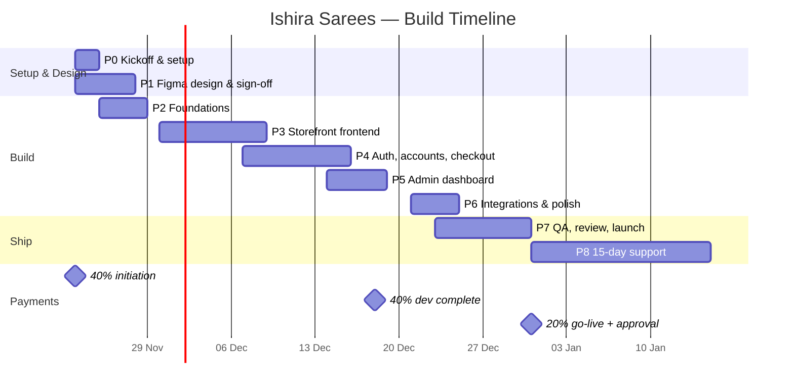

# Ishira Sarees — Implementation Plan

> How and when we build the Ishira Sarees e-commerce website.
> Requirement IDs (`FR-…`, `NFR-…`, `Q…`) refer to [ProjectSpecification.md](ProjectSpecification.md).
> Budget **₹72,000** · Duration **5–6 weeks** · Support **15 days** after delivery.

---

## 1. Summary & Build Principles

We are building a premium, editorial e-commerce storefront for a small, curated collection of Kanchipuram silk sarees. It is UAE-only and priced in AED. The stack is Next.js + Supabase + Stripe + Cloudinary + Resend, hosted on Vercel.

**Principles**
1. **Build to the TRD and spec only.** Anything else is a change request. Flag ambiguity to Rajesh before assuming.
2. **Design before build.** No page is coded before its Figma template is client-approved.
3. **Mobile-first shopping flow.** Catalogue → product → cart → checkout is designed, built and tested at mobile width first.
4. **The server decides prices.** The client never sends prices. `priceCart()` is the single pricing function.
5. **The webhook is the source of payment truth.** Orders become `paid` only in the Stripe webhook.
6. **RLS on every table from the first migration.** Security is never left for later.
7. **Imagery first.** Cloudinary transforms and `next/image` are used from day one, not bolted on in week 5.
8. **Small, reviewable PRs.** Every PR gets a Vercel preview, and `main` is always deployable.

---

## 2. Timeline Overview

Assumed kickoff: **Monday 23 Nov 2026**. Shift all dates if kickoff moves. Note the UAE New Year holiday on 1 Jan.

| Week | Dates (indicative) | Focus (TRD §10) | Phases | Milestone |
|---|---|---|---|---|
| 1 | 23–27 Nov | UI/UX design in Figma: all templates, theme, editorial styling, client approval | P0, P1 (+ P2 scaffold in parallel) | **M1:** Kickoff, **40% payment**. Figma sign-off by Fri. |
| 2 | 30 Nov–4 Dec | Frontend build: home, catalogue, PDP | P2, P3 | Storefront browsable on preview with seed data |
| 3 | 7–11 Dec | Frontend: cart, static pages · Backend: auth, accounts, cart persistence | P3, P4 | First PDP validated against sample shots |
| 4 | 14–18 Dec | Backend: checkout + Stripe + webhook · Admin dashboard | P4, P5 | **M2:** Frontend + backend core complete, **40% payment** |
| 5 | 21–25 Dec | Cloudinary polish, Resend emails, invoices, SEO, QA across devices | P6, P7 | Feature-complete release candidate on staging |
| 6 | 28 Dec–1 Jan (+ buffer) | Client review, revisions, final testing, production deployment, handover | P7 | **M3:** Go-live + approval, **20% payment**. 15-day support starts. |



**Critical path:** Figma sign-off → storefront build → checkout + webhook → QA → go-live.
**Things that commonly cause slippage:** late client inputs (§17): Stripe account activation, DNS access, and sample photography.

---

## 3. Phase 0 — Kickoff & Setup (Week 1, Days 1–2)

**Goal:** accounts, repo and decisions are in place so the build is never blocked.

### Tasks
- [ ] Kickoff call with client: walk through scope (spec §3), timeline, and the client dependencies list (§17)
- [ ] Send the client the **Open Questions Q1–Q11** (spec §15) with a 3-day answer deadline
- [ ] Send the **image and content guidelines** (spec §13) to the client's social media team
- [ ] Collect the 40% initiation payment (M1)
- [ ] Client creates the **Stripe** account (UAE entity, KYC) and invites Webcros as a developer
- [ ] Create **Supabase** org and projects: `ishira-dev` and `ishira-prod`. Client is the billing owner.
- [ ] Create the **Vercel** team and project, linked to the Git repo. Client is the billing owner.
- [ ] Create the **Cloudinary** account (client billing) and the `ishira/` folder structure
- [ ] Create the **Resend** account. Generate the DNS records and send them to the client to add.
- [ ] Get **domain / DNS access**, or a named contact who can add records (Q8)
- [ ] Repo init:
  - [ ] `pnpm create next-app` (TypeScript, App Router, Tailwind v4, ESLint, `src/` dir)
  - [ ] Prettier + `prettier-plugin-tailwindcss`, strict `tsconfig`, path alias `@/*`
  - [ ] Husky + lint-staged (lint + typecheck on commit)
  - [ ] `.env.example` with all variables from spec §11.4. Add `.env*.local` to gitignore.
  - [ ] Supabase CLI init (`supabase/` folder), plus local Supabase via Docker for development
  - [ ] Vitest + Playwright installed with one smoke test each
  - [ ] GitHub repo with branch protection on `main`. Vercel preview deploys on PRs.

**Definition of done:** a repo deploys "Hello Ishira" to a Vercel preview, all service accounts exist, and the open questions have been sent.

---

## 4. Phase 1 — Design in Figma (Week 1)

**Goal:** every page template is approved by the client before its development starts.

### Tasks
- [ ] Finalise homepage direction (V4) in Figma file `VoITM0QdfODZgG3nbU9MsT`
  - [ ] Palette: avoid banned pairings (maroon/red + gold, navy + red, leaf green + white, violet + white). Muted base so silk colours lead.
  - [ ] Typography: serif display + sans body. **No Instrument Serif.**
  - [ ] No women's faces in imagery. No religious motifs (no lotus).
- [ ] Design templates (desktop + mobile for each):
  - [ ] Homepage (hero, brand story, featured/new arrivals, footer)
  - [ ] Catalogue (grid, filter drawer/sidebar, sort, quick-view, empty state)
  - [ ] PDP (gallery + zoom, specs, story, related, sticky mobile CTA, stock states)
  - [ ] Cart drawer + cart page
  - [ ] Checkout (contact, address, delivery, payment, summary) + success page
  - [ ] Auth (login, register, forgot/reset)
  - [ ] Account (dashboard, orders, order detail, addresses, wishlist)
  - [ ] About / Brand Story, Contact, policy page, 404
  - [ ] Admin: a lighter-weight design system pass (list, form, detail, dashboard cards). Functional, on-brand, not editorial.
  - [ ] Email templates (order confirmation, shipped): one layout
  - [ ] Invoice PDF layout
- [ ] Define **design tokens** (colour, type scale, spacing, radii, breakpoints) as Figma variables, ready to map to Tailwind `@theme`
- [ ] Component inventory: button, input, select, checkbox, badge, card, modal, drawer, accordion, tabs, toast, pagination
- [ ] Client review round, then sign-off (written, email OK)

**Dependencies:** client brand assets (logo, any existing brand guidelines).
**Definition of done:** client has approved all storefront templates in writing, and tokens are exported.
**Closes:** spec §4, TRD §1.1, TRD §10 week 1.

---

## 5. Phase 2 — Foundations (Week 1 end → Week 2 start)

**Goal:** a shared base that every feature builds on. It can start while Figma is finishing, because nothing here depends on visual details beyond the tokens.

### Tasks
**Theme & layout**
- [ ] Tailwind v4 `@theme` with Figma tokens. Load fonts via `next/font`.
- [ ] Base UI primitives (`src/components/ui/*`) per the Figma component inventory
- [ ] Storefront layout shell: header (nav per FR-HOME-02, cart icon + count, wishlist, account), mobile menu, footer
- [ ] `formatAED()` and date helpers (`en-AE`, `Asia/Dubai`) — NFR-I18N-01
- [ ] Error boundaries, `not-found.tsx` (FR-STAT-04), loading skeletons

**Supabase**
- [ ] `lib/supabase/client.ts` (browser), `server.ts` (RSC/actions, cookies), `admin.ts` (service role, `server-only`)
- [ ] `middleware.ts`: session refresh; guard `/account/**` and `/admin/**`
- [ ] Migration `0001_init.sql`: enums, all tables, indexes, sequences, `updated_at` triggers (spec §9)
- [ ] Migration `0002_rls.sql`: enable RLS on every table, add `is_admin()` and all policies (spec §10.1)
- [ ] Migration `0003_functions.sql`:
  - [ ] `finalize_paid_order`
  - [ ] `restock_order`
  - [ ] `merge_guest_cart`
  - [ ] analytics RPCs
  - [ ] the `on auth.users insert` trigger, which creates the customer and links guest orders (FR-ACC-06)
- [ ] `supabase gen types typescript` → `src/types/database.ts`. Add a script to the npm scripts.
- [ ] `supabase/seed.sql`: 3 categories, 12 sample sarees with placeholder Cloudinary images, 1 coupon, `store_settings` row, 1 admin user

**Cloudinary**
- [ ] Custom `next/image` loader (`lib/cloudinary/loader.ts`) plus transform presets (card, gallery, zoom, OG) — spec §11.2

**Definition of done:** the layout shell renders on preview, migrations apply cleanly to local and dev, generated types compile, and RLS is on for all tables (checked with `select relname from pg_class where relrowsecurity = false` on public tables → empty).

---

## 6. Phase 3 — Storefront Frontend (Weeks 2–3)

**Goal:** a browsable, responsive storefront on real data (seed first, then client data).

### 6.1 Homepage — FR-HOME-01…06
- [ ] Editorial hero (full-bleed, `priority` image, copy, two CTAs)
- [ ] Brand story section (content in `src/content/home.ts`)
- [ ] Featured / New Arrivals: query `is_featured` ordered by `featured_rank`. Tag cache `products`.
- [ ] Responsive QA at 360 / 768 / 1024 / 1440 px

### 6.2 Catalogue — FR-CAT-01…07
- [ ] `/shop` and `/collections/[slug]` share a `<Catalogue>` server component
- [ ] `lib/catalogue/query.ts`: builds a Supabase query from parsed search params (Zod-validated) for filters, sort and pagination (`range`)
- [ ] Facet values: distinct colours, weaves, categories, min/max price from active products (cached)
- [ ] Filter UI: sidebar on desktop, bottom-sheet drawer on mobile. URL state via `useRouter().replace`.
- [ ] Sort select. "Load more" (page size 12).
- [ ] Product card: 4:5 image, hover second image, name, price, stock badge, wishlist heart
- [ ] Quick-view modal: hover on desktop, button on touch, accessible dialog
- [ ] Empty state

### 6.3 Product Detail — FR-PDP-01…08
- [ ] `/product/[slug]` with `generateStaticParams`, plus revalidation by tag `product:{id}`
- [ ] Gallery: thumbnails, swipe (CSS scroll-snap), desktop hover-zoom lens, fullscreen lightbox with pinch-zoom on mobile
- [ ] Specs list (hide empty), story section (Markdown, no HTML)
- [ ] Price, qty (only if stock > 1 per Q6), Add to Cart, sticky mobile CTA bar
- [ ] Stock indicator logic in `lib/catalogue/stock.ts` (shared with cards and admin)
- [ ] Related products: curated, then fallback by category/weave
- [ ] `generateMetadata`, OG image, JSON-LD `Product` + `BreadcrumbList`
- [ ] **Early validation:** as soon as the client sends sample shots, load one real saree and review the PDP with the client (TRD §6 recommendation)

### 6.4 Cart (UI) — FR-CART-01, 02, 04
- [ ] Zustand cart store with `persist` (localStorage) for guests: `{ productId, qty }[]` only, never prices
- [ ] Cart drawer (opens on add) + `/cart` page
- [ ] Summary is rendered from the server action `priceCart(items, couponCode?)`. It returns lines, subtotal, discount, shipping estimate and total, plus problems such as sold out or qty clamped.
- [ ] Header cart count

### 6.5 Static pages — FR-STAT-01…04
- [ ] About / Brand Story, Contact (form UI), policy page template (Markdown in `src/content/policies/*.md`), 404

**Definition of done:** a user can browse, filter, sort, open quick-view, view a PDP and build a cart on a mobile preview. Lighthouse mobile ≥ 85 on home, shop and PDP with seed images.

---

## 7. Phase 4 — Backend, Auth, Accounts & Checkout (Weeks 3–4)

**Goal:** real accounts and real (test-mode) payments end to end.

### 7.1 Auth — FR-ACC-01, 05
- [ ] Register, login and logout server actions (Supabase Auth, Zod-validated)
- [ ] `/auth/callback` route (code exchange). Forgot/reset password pages.
- [ ] Supabase Auth email templates branded and sent via Resend SMTP
- [ ] Redirect handling with `?next=` (safe internal paths only)

### 7.2 Account area — FR-ACC-02…04, 06
- [ ] `/account` dashboard
- [ ] Orders list + detail (status timeline from `order_status_history`, tracking, invoice link)
- [ ] Addresses CRUD (emirate select, default toggle)
- [ ] Wishlist: toggle server action (optimistic UI) on card, quick-view and PDP. `/account/wishlist` with move-to-cart.
- [ ] Profile (name, phone, change password)

### 7.3 Cart persistence & coupons — FR-CART-03, 05
- [ ] DB cart server actions: add, update, remove, get
- [ ] On login: call `merge_guest_cart(localItems)` and clear localStorage
- [ ] Cart store switches source (local vs DB) based on the session
- [ ] `lib/pricing/coupon.ts`: validation rules (active, dates, min order, usage limit)
- [ ] `lib/pricing/shipping.ts`: reads `store_settings.shipping_rules` (flat or tiered per Q1)
- [ ] `lib/pricing/price-cart.ts`: the **single pricing function** used by cart, checkout and order creation. It has full unit-test coverage.

### 7.4 Checkout & Stripe — FR-CHK-01…07, 10, 11
- [ ] `/checkout` page:
  1. contact (email/phone, or prefilled if logged in)
  2. shipping address (saved-address picker for users)
  3. delivery option
  4. payment (Stripe Payment Element)
  5. order summary
- [ ] Server action `createOrUpdateCheckout(input)`:
  1. Zod-validate the input
  2. re-price with `priceCart`
  3. check stock
  4. upsert a `pending` order + `order_items` snapshots (service role)
  5. create or update the PaymentIntent (`amount` in fils, `currency: 'aed'`, `metadata.order_id`, `receipt_email`)
  6. return the `client_secret`
- [ ] Client: `stripe.confirmPayment({ return_url: /checkout/success })`. Show Stripe's error messages inline and let the user retry with the same PI.
- [ ] Route handler `/api/webhooks/stripe` (Node runtime, raw body):
  - [ ] Verify the signature, then insert into `stripe_events` (on conflict, return 200 early — idempotent)
  - [ ] `payment_intent.succeeded`:
    1. `finalize_paid_order`
    2. generate the invoice PDF and upload it to Storage
    3. send the confirmation email with the invoice attached
    4. send the store notification (Q10)
    5. clear the user's DB cart
    6. revalidate the product tags
  - [ ] `payment_intent.payment_failed`: set `payment_status = 'failed'`
  - [ ] `charge.refunded`: set status `refunded`, run `restock_order`, send email
- [ ] `/checkout/success`: poll the order status (2 s, max 30 s), then show the confirmation (FR-CHK-07). Clear the guest localStorage cart.
- [ ] pg_cron job `cancel_stale_pending_orders` (hourly)
- [ ] Apple Pay: register the preview and staging domains in Stripe test mode and test on an iPhone

**Definition of done:** on staging, a guest and a registered user can each buy a saree with a Stripe test card, and with Apple Pay on iOS. The order shows as paid, stock decrements, the email (with invoice) arrives, and replaying the webhook with Stripe CLI changes nothing.

---

## 8. Phase 5 — Admin Dashboard (Week 4)

**Goal:** the client can run the store without a developer.

### Tasks
- [ ] `app/admin/layout.tsx`: `requireAdmin()` guard (404 on failure), sidebar nav, responsive (FR-ADM-01, FR-RESP-04)
- [ ] `lib/auth/require-admin.ts`, used in every admin page, server action and route handler
- [ ] **Overview** `/admin`: cards for orders, revenue and AOV (7d / 30d / all), top 5 best sellers, low-stock list, recent orders (FR-ADM-07, 04)
- [ ] **Products** list: search, status filter, stock column with inline edit, featured toggle + rank (FR-ADM-02, 04, 09)
- [ ] **Product form** (new/edit): all fields, slug auto-generation, categories multi-select, related-products picker, SEO fields, Zod validation. Archive instead of delete when orders exist.
- [ ] **Image manager**: signed upload via `/api/cloudinary/sign`, drag-drop multi-upload, reorder (dnd-kit), alt text, delete, low-resolution / wrong-ratio warning (FR-ADM-03)
- [ ] **Categories** CRUD (FR-ADM-11)
- [ ] **Orders** list: status and date filters, search by order number or email (FR-ADM-05)
- [ ] **Order detail**:
  - [ ] customer, address, items, payment status, Stripe dashboard link
  - [ ] status transition buttons, carrier and tracking fields
  - [ ] history log
  - [ ] resend confirmation email, download invoice
  - [ ] the "shipped" transition sends the shipped email
- [ ] **Customers** list + detail (orders, addresses, totals) (FR-ADM-06)
- [ ] **Coupons** CRUD; deactivate only if used (FR-ADM-08)
- [ ] **Settings**: shipping rules, thresholds, invoice seller details, contact email (FR-ADM-10)
- [ ] After any product, category or featured change, call `revalidateTag()` so the storefront updates

**Definition of done:** the client-role walkthrough works end to end: add a saree with images, mark it featured, see it on the homepage, place an order, move it to shipped (email arrives), create a coupon and use it at checkout.

**→ Milestone M2 (end of week 4):** frontend + backend core complete. Demo to the client and invoice the second 40%.

---

## 9. Phase 6 — Integrations & Polish (Week 5)

### Tasks
**Cloudinary** — FR-RESP-03, NFR-PERF-02
- [ ] Final transform presets. `sizes` audit on every image. Blur placeholders. Verify no image is served at more than 2× its rendered width.
- [ ] Upload the client's real photography and products (or train the client to do it in admin)

**Resend emails** — FR-CHK-08, spec §11.3
- [ ] React Email templates: order confirmation, shipped, delivered, cancelled/refunded, contact-to-store, new-order-to-store
- [ ] Test rendering in Gmail (web + app), Outlook and iOS Mail
- [ ] Domain verified (SPF/DKIM/DMARC) and DMARC alignment checked
- [ ] Contact form server action with honeypot + rate limit (FR-STAT-02)

**Invoices** — FR-CHK-09
- [ ] `@react-pdf/renderer` template (brand header, seller details, invoice number, line items, discount, shipping, VAT line per Q2, totals in AED)
- [ ] Upload to the private `invoices` bucket. `/api/invoice/[orderId]` returns a signed URL to the owner or admin.

**SEO** — NFR-SEO-01…03
- [ ] Metadata on every route, canonical URLs, `app/sitemap.ts`, `app/robots.ts`
- [ ] OG images (static for pages, Cloudinary crop for products)
- [ ] JSON-LD: Organization, Product, BreadcrumbList. Validate with Rich Results Test.

**Performance & accessibility** — NFR-PERF-01, NFR-A11Y-01
- [ ] Lighthouse mobile pass on home, shop, PDP and checkout. Fix the LCP, CLS and JS weight issues it finds.
- [ ] Bundle analysis. Make sure Stripe JS loads only on checkout.
- [ ] axe pass, keyboard-only walkthrough, reduced-motion support

**Security hardening** — spec §10.2
- [ ] Security headers + CSP in `next.config.ts`
- [ ] Run the Supabase security advisor. Fix every warning.

**Definition of done:** feature-complete release candidate on staging, Lighthouse targets met, all emails verified.

---

## 10. Phase 7 — QA, Client Review & Launch (Weeks 5–6)

### 10.1 QA test plan
| Area | Cases |
|---|---|
| Catalogue | Every filter alone and combined; each sort; pagination; empty state; URL sharing; back button |
| PDP | Gallery swipe/zoom; stock states (in / low / sold out); related; wishlist (guest → login redirect) |
| Cart | Add/update/remove; qty clamp; sold-out item blocks checkout; coupon valid / expired / min-order / exhausted; guest → login merge |
| Checkout | Guest + registered; address validation (emirate, +971 phone); each delivery option; Stripe test cards (`4242…` success, `4000 0000 0000 9995` decline, `4000 0025 0000 3155` 3-D Secure); Apple Pay on iPhone; out-of-stock race (two buyers, qty 1) |
| Webhook | Replay with Stripe CLI (idempotent); failed payment; refund → restock + email |
| Accounts | Register (confirm email), login, reset password, orders, invoice download, addresses, wishlist, guest-order linking |
| Admin | Non-admin blocked (404 + RLS); product CRUD + images; inventory; order status flow + emails; customers; analytics numbers vs SQL; coupons; settings |
| Emails | All templates in Gmail / Outlook / iOS Mail; links work; invoice attached |
| SEO | Sitemap valid; robots disallows private paths; OG previews (WhatsApp, Instagram, Facebook debugger) |

### 10.2 Cross-device matrix — NFR-BRW-01
| Device | Browser |
|---|---|
| iPhone (recent) | Safari: **full checkout + Apple Pay** |
| Android (mid-range) | Chrome: full checkout |
| iPad | Safari: browse + admin order update |
| Windows | Chrome, Edge, Firefox |
| macOS | Safari, Chrome |

### 10.3 Client review
- [ ] Hand the staging URL and a test checklist to the client
- [ ] One consolidated revision round (minor UI and copy). Anything new goes to the change-request log.
- [ ] Client final approval in writing

### 10.4 Production cutover checklist
- [ ] `ishira-prod` Supabase: apply migrations, seed `store_settings` and the admin user, enable pg_cron, create the invoices bucket, set Auth redirect URLs and SMTP
- [ ] Stripe **live** keys in Vercel production env. Create the live webhook endpoint and set `STRIPE_WEBHOOK_SECRET`.
- [ ] **Apple Pay domain verification** on the production domain (live mode)
- [ ] Domain attached in Vercel, DNS records added, HTTPS active, `www` → apex redirect decided
- [ ] Resend domain verified for production. `EMAIL_FROM` set.
- [ ] Cloudinary production folder in place, real product images uploaded
- [ ] Policy pages live (Q7). Stripe account shows the policy URLs.
- [ ] `NEXT_PUBLIC_SITE_URL` = production URL. Sitemap submitted in Google Search Console.
- [ ] Smoke test: one **real** low-value purchase, then a refund through the Stripe Dashboard. Verify the email and the restock.
- [ ] Remove seed and test data from production

### 10.5 Handover — TRD §11
- [ ] Admin user guide (PDF/Markdown, with screenshots): add a saree, upload images, manage stock, fulfil an order, coupons, settings
- [ ] Credentials and ownership document: every account is client-owned, and Webcros access is listed
- [ ] Short Loom or video walkthrough of the admin area *(optional, nice-to-have)*
- [ ] Repo access transferred or shared per agreement

**→ Milestone M3:** go-live + final approval. Invoice the final 20%. The 15-day support window starts.

---

## 11. Phase 8 — 15-Day Support Window

| Covered (free) | Not covered (billed hourly / change request) |
|---|---|
| Bug fixes against this spec | New features or pages |
| Minor UI adjustments (spacing, copy, colours) | Major design changes |
| Configuration help (settings, coupons) | New integrations (courier APIs, WhatsApp commerce, etc.) |
| | Content entry beyond handover training |

**Process:** the client reports issues by email or WhatsApp. Each one is logged with severity (P1 checkout down: same day; P2 feature broken: 2 business days; P3 cosmetic: batched). Fixes ship via PR → preview → production.

---

## 12. Project Structure

```
ishira/
├─ src/
│  ├─ app/
│  │  ├─ (store)/                 # public storefront layout (header/footer)
│  │  │  ├─ page.tsx              # homepage
│  │  │  ├─ shop/page.tsx
│  │  │  ├─ collections/[slug]/page.tsx
│  │  │  ├─ product/[slug]/page.tsx
│  │  │  ├─ cart/page.tsx
│  │  │  ├─ checkout/page.tsx
│  │  │  ├─ checkout/success/page.tsx
│  │  │  ├─ about/page.tsx
│  │  │  ├─ contact/page.tsx
│  │  │  └─ policies/[slug]/page.tsx
│  │  ├─ (auth)/                  # login, register, forgot-password, reset-password
│  │  ├─ account/                 # dashboard, orders, addresses, wishlist, profile
│  │  ├─ admin/                   # products, categories, orders, customers, coupons, settings
│  │  ├─ auth/callback/route.ts
│  │  ├─ api/
│  │  │  ├─ webhooks/stripe/route.ts
│  │  │  ├─ cloudinary/sign/route.ts
│  │  │  └─ invoice/[orderId]/route.ts
│  │  ├─ sitemap.ts
│  │  ├─ robots.ts
│  │  ├─ not-found.tsx
│  │  └─ layout.tsx
│  ├─ components/
│  │  ├─ ui/                      # primitives (button, input, dialog, drawer…)
│  │  ├─ store/                   # product-card, quick-view, gallery, filters, cart-drawer…
│  │  ├─ checkout/
│  │  ├─ account/
│  │  └─ admin/
│  ├─ lib/
│  │  ├─ supabase/                # client.ts, server.ts, admin.ts (server-only)
│  │  ├─ stripe/                  # server.ts, client.ts, webhook handlers
│  │  ├─ cloudinary/              # loader.ts, presets.ts, sign.ts
│  │  ├─ email/                   # send.ts (Resend wrapper)
│  │  ├─ pricing/                 # price-cart.ts, coupon.ts, shipping.ts  ← unit-tested
│  │  ├─ catalogue/               # query.ts, facets.ts, stock.ts
│  │  ├─ invoice/                 # invoice-pdf.tsx, generate.ts
│  │  ├─ auth/                    # require-user.ts, require-admin.ts
│  │  ├─ validation/              # zod schemas (address, checkout, product, coupon…)
│  │  └─ format.ts                # formatAED, dates
│  ├─ actions/                    # server actions grouped by domain (cart, checkout, account, admin/*)
│  ├─ stores/cart.ts              # zustand guest cart
│  ├─ emails/                     # React Email templates
│  ├─ content/                    # home.ts, about.md, policies/*.md
│  ├─ types/database.ts           # generated Supabase types
│  └─ middleware.ts
├─ supabase/
│  ├─ migrations/                 # 0001_init.sql, 0002_rls.sql, 0003_functions.sql …
│  ├─ seed.sql
│  └─ tests/                      # RLS tests (pgTAP)
├─ tests/
│  ├─ unit/                       # vitest
│  └─ e2e/                        # playwright
├─ public/
├─ .env.example
├─ next.config.ts
└─ package.json
```

---

## 13. Key Flows in Detail

### 13.1 Checkout → payment → order finalised
```mermaid
sequenceDiagram
  autonumber
  participant U as Customer (browser)
  participant N as Next.js server action
  participant DB as Supabase
  participant S as Stripe
  participant W as /api/webhooks/stripe
  participant R as Resend

  U->>N: createOrUpdateCheckout(cart items, address, delivery, coupon)
  N->>DB: load products (price, stock), coupon, store_settings
  N->>N: priceCart() + stock check
  N->>DB: upsert pending order + order_items (service role)
  N->>S: create/update PaymentIntent (aed, metadata.order_id)
  S-->>N: client_secret
  N-->>U: client_secret
  U->>S: confirmPayment (card / Apple Pay, 3DS if needed)
  S-->>U: redirect /checkout/success?payment_intent=…
  S->>W: payment_intent.succeeded (signed)
  W->>DB: insert stripe_events (idempotency)
  W->>DB: finalize_paid_order() — stock↓, sold_count↑, coupon used↑, status=paid, invoice no.
  W->>W: render invoice PDF → Storage
  W->>R: order confirmation (+PDF) & store notification
  W->>DB: clear customer cart; revalidate product tags
  U->>DB: success page polls order → status=paid → show confirmation
```

**Edge cases**
- *Stock sold out between checkout and payment* (qty-1 race): `finalize_paid_order` detects that stock is insufficient. It marks the order `paid` but flags it with a note and alerts the store by email, so the admin can refund it from Stripe. This is rare with a small catalogue, and the pre-payment stock check makes it unlikely.
- *The user closes the tab after paying*: the webhook still finalises the order and sends the email.
- *Payment fails*: the user stays on checkout, Stripe shows the error, and they retry with the same PaymentIntent.
- *An abandoned pending order*: cancelled by pg_cron after 24 h. Stock was never touched.

### 13.2 Guest cart → login merge
1. A guest adds items, which go to localStorage (`{productId, qty}`).
2. The guest logs in, and `onAuthStateChange` fires. The client calls the `mergeGuestCart(localItems)` action.
3. `merge_guest_cart` upserts into `cart_items`, sums quantities, and clamps them to `stock_qty`.
4. localStorage is cleared. From now on the cart store reads from the DB.

### 13.3 Admin image upload
1. The admin drops files in the image manager.
2. The client requests a signature from `/api/cloudinary/sign`. The route checks `requireAdmin()`, then signs the `folder` and `timestamp` params.
3. The browser uploads directly to Cloudinary, which returns `public_id`, `secure_url`, `width` and `height`.
4. The client warns if the image is smaller than 2000×2500 or not 4:5.
5. A server action inserts `product_images` rows. Reordering updates `sort_order`.
6. `revalidateTag('product:{id}')`.

### 13.4 Order status change
1. The admin clicks "Mark as shipped" and enters the carrier and tracking number.
2. A server action runs `requireAdmin()`, checks the transition is valid (`processing → shipped`), updates the order, and inserts into `order_status_history`.
3. The "Order shipped" email is sent via Resend.
4. The customer's order page shows the updated timeline and tracking.

---

## 14. Testing Strategy

| Layer | Tool | What | When |
|---|---|---|---|
| Unit | Vitest | `priceCart`, coupon rules, shipping rules, `formatAED`, stock state, search-param parsing | Every PR (CI) |
| DB / RLS | pgTAP via `supabase test db` | Anon can't read drafts; user A can't read user B's orders, addresses or wishlist; non-admin can't write products; only service role writes orders | Every migration change |
| E2E | Playwright (mobile + desktop projects) | ① browse → filter → PDP → add → checkout (guest, Stripe test card) → success; ② register → wishlist → checkout with saved address; ③ admin creates product → visible in shop; ④ admin marks order shipped | Nightly on staging + before release |
| Webhook | Stripe CLI (`stripe listen`, `stripe trigger`, event resend) | Success, failure, refund, duplicate delivery | Phase 4 + release |
| Visual / manual | Device matrix (§10.2) | Layout fidelity against Figma | Phase 7 |
| Performance | Lighthouse CI (or manual) | NFR-PERF-01 thresholds | Phase 6–7 |
| Accessibility | axe DevTools + keyboard pass | NFR-A11Y-01 | Phase 6 |

**CI (GitHub Actions or the Vercel build step):** `pnpm lint && pnpm typecheck && pnpm test`. Playwright runs against preview deploys for PRs that touch `checkout/`, `lib/pricing/` or `api/webhooks/`.

---

## 15. Environments & Deployment

| Environment | Git | Vercel | Supabase | Stripe | Purpose |
|---|---|---|---|---|---|
| Local | feature branch | `next dev` | Local Docker (`supabase start`) | Test mode + `stripe listen` | Development |
| Preview | PR | Preview deploy | `ishira-dev` | Test mode | Review each PR |
| Staging | `main` (pre-launch) | Production deploy on a staging domain | `ishira-dev` | Test mode | Client review + QA |
| Production | `main` (post-launch) | Production deploy on the client domain | `ishira-prod` | **Live** | Live store |

**Migrations:** written in `supabase/migrations`, applied locally first, then `supabase db push` to dev, then to prod at cutover and on each release. Prod is never edited by hand.
**Releases:** merge to `main`, then Vercel auto-deploys. Rollback uses Vercel "Promote previous deployment". DB migrations must be backward-compatible (additive) so rollback stays safe.

---

## 16. Risks & Mitigations

| # | Risk | Likelihood | Impact | Mitigation |
|---|---|---|---|---|
| R1 | Client photography arrives late or off-spec | High | High | Send the spec §13 guidelines on day 1. Build with placeholders. Validate one PDP against sample shots early. The admin warns on off-spec uploads. |
| R2 | Stripe UAE account activation / KYC is slow | Medium | High | Client starts Stripe on day 1. Build entirely in test mode. Live activation is only needed for cutover. |
| R3 | Apple Pay domain verification issues | Medium | Medium | Verify on staging in test mode during Phase 4. Production verification is in the cutover checklist. |
| R4 | Resend / DNS records delayed (client controls DNS) | Medium | Medium | Send DNS records in Phase 0. Use the Resend test domain until then. |
| R5 | Open questions (shipping, VAT) unanswered | Medium | Medium | Defaults are documented in spec §15. The engine is configurable via `store_settings`, so answers are just config. |
| R6 | Scope creep ("can we also…") | High | High | Change-request log. Refer every request to spec §3. Quote separately. |
| R7 | Design approval drags past week 1 | Medium | High | Approve page by page. Foundations and backend proceed in parallel. Escalate if not signed off by day 7. |
| R8 | Oversell of one-of-a-kind sarees (qty 1 race) | Low | Medium | Pre-payment stock check + atomic `finalize_paid_order` + admin alert with refund path (§13.1). |
| R9 | Holiday period (late Dec / 1 Jan) slows client feedback | Medium | Medium | Agree review dates at kickoff. Keep week 6 as buffer. |
| R10 | Image-heavy pages miss Core Web Vitals | Medium | Medium | Cloudinary loader from Phase 2. Lighthouse checks each phase, not just at the end. |

---

## 17. Client Dependencies Checklist

| # | Item | Needed by | Blocks |
|---|---|---|---|
| C1 | Answers to Open Questions Q1–Q11 | Day 3 | Shipping, invoice, nav, coupon logic |
| C2 | Brand assets: logo (SVG), any brand guidelines | Day 2 | Figma finalisation |
| C3 | Stripe account created (UAE entity), Webcros invited | Day 2 (start KYC) | Live payments at cutover |
| C4 | Domain registrar / DNS access or a contact | Day 5 | Resend, Vercel domain, Apple Pay |
| C5 | Figma feedback and sign-off | Day 5 | Frontend build |
| C6 | Sample photography (2–3 sarees, full shot list) | End of week 2 | PDP validation |
| C7 | Homepage + About copy (founder narrative, craft story) | End of week 2 | Homepage, About |
| C8 | Full product data (spec §13.3) + photography for the launch collection | End of week 4 | Content load, QA |
| C9 | Policy page texts (shipping, returns, privacy, terms) | End of week 4 | Go-live (Stripe requirement) |
| C10 | Contact / notification inbox, social links, WhatsApp number | Week 3 | Contact page, emails |
| C11 | Staging review feedback (one consolidated list) | Week 6, day 2 | Go-live |
| C12 | Payments: 40% / 40% / 20% per milestones | M1 / M2 / M3 | — |

Per the quote T&Cs, the timeline may shift with late client inputs or extended revision cycles.

---

## 18. Handover Deliverables (TRD §11)

- [ ] Fully functional, responsive e-commerce website live on the agreed domain
- [ ] Admin dashboard with product, inventory, order, customer, coupon and analytics management
- [ ] Stripe payments (cards + Apple Pay) live and tested with a real transaction
- [ ] Order confirmation and transactional emails working via Resend, with invoices attached
- [ ] Basic SEO: meta tags, sitemap, Open Graph, JSON-LD
- [ ] Admin user guide + credentials and ownership document
- [ ] Source code repository access
- [ ] 15 days of free post-launch support (bug fixes + minor UI adjustments)

---

## Appendix A — Requirement → Phase Map

| Requirement IDs | Phase |
|---|---|
| Spec §4 design, tokens | P1 |
| NFR-I18N-01, NFR-OPS-01, §9 schema, §10.1 RLS | P0–P2 |
| FR-HOME-01…06 | P3 |
| FR-CAT-01…07 (FR-CAT-08 if Q3 = yes) | P3 |
| FR-PDP-01…08 | P3 (+ SEO in P6) |
| FR-CART-01, 02, 04 | P3 |
| FR-CART-03, 05 | P4 |
| FR-CHK-01…07, 10, 11 | P4 |
| FR-CHK-08, 09 | P4 (wiring) + P6 (templates) |
| FR-ACC-01…06 | P4 |
| FR-ADM-01…11 | P5 |
| FR-STAT-01, 03, 04 | P3 |
| FR-STAT-02 | P3 (UI) + P6 (email) |
| FR-RESP-01…04 | P3–P5 (built in), P7 (verified) |
| NFR-PERF-*, NFR-SEO-*, NFR-A11Y-01, §10.2 hardening | P6 |
| NFR-BRW-01, NFR-REL-01 | P7 |

## Appendix B — Quote Cost Areas → Phases

The quote's ₹80,000 breakdown was later finalised at ₹72,000. The areas still describe where effort goes:

| Quote area | Phase(s) |
|---|---|
| UI/UX Design | P1 |
| Frontend Development | P2, P3 |
| Product Catalogue & Cart | P3, P4 (7.3) |
| Checkout & Payment Gateway | P4 (7.4), P6 (invoices) |
| Customer Accounts & Auth | P4 (7.1, 7.2) |
| Admin Dashboard & CMS | P5 |
| Database & Cloud Setup | P0, P2 |
| SEO & Performance | P6 |
| Testing & Deployment | P7 |
