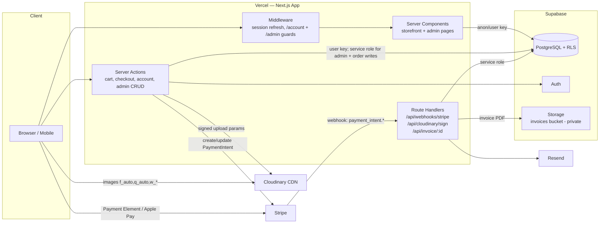
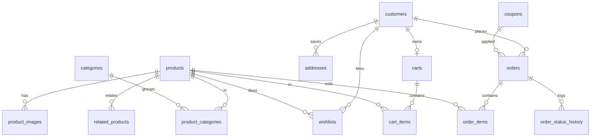

# Ishira Sarees — Project Specification

> E-commerce website for Ishira Sarees, a Dubai-based boutique selling pure handloom Kanchipuram silk sarees.
> This document is the developer-facing specification: **what** to build. The companion [ImplementationPlan.md](ImplementationPlan.md) covers **how and when**.

---

## 1. Document Control

| Field | Detail |
|---|---|
| Client | Ishira Sarees (Dubai, UAE) |
| Project | Ishira Sarees E-Commerce Website |
| Vendor | Webcros (Talagana Rajesh, Consultant) |
| Quote reference | No. 2026/EC/18 (October 2026) |
| Agreed budget | **₹72,000** (final, per TRD dated 03 Nov 2026) |
| Estimated duration | 5–6 weeks |
| Free support | 15 days post-delivery (bug fixes + minor UI adjustments) |
| Payment milestones | 40% initiation · 40% after development completion (frontend + backend core) · 20% after deployment and final approval |
| Source documents | Technical Requirements Document (TRD, 03 Nov 2026); Comprehensive Project Quotation 2026/EC/18 |

### 1.1 Source-of-truth rule
1. The **TRD** is the binding build spec. Where it and the quote differ, the TRD wins.
   - Budget: the quote shows ₹80,000 (negotiable). The TRD records the final agreed **₹72,000**. Use ₹72,000 everywhere.
2. This document expands the TRD into testable requirements. It adds **implementation detail only**: data fields, flows, security policies. It adds **no new features**. Where the TRD's own requirements imply something it doesn't name, that addition is marked **(implied)**. An example is a DB cart table, needed so carts persist for logged-in users.
3. Anything that is genuinely ambiguous is listed in [§15 Open Questions](#15-open-questions--client-decisions). The team must not resolve these by assumption.
4. Anything outside this document is a **change request** and is billed separately.

### 1.2 Version history

| Version | Date | Author | Notes |
|---|---|---|---|
| 1.0 | 21 Nov 2026 | Webcros | Initial specification from TRD + quote |

---

## 2. Project Overview & Goals

Ishira Sarees sells a **small, curated collection** of pure handloom Kanchipuram silk sarees to customers in the **UAE only**. The site must feel like a fashion editorial or lookbook. Sarees and their craft story come first, not a generic template storefront.

### 2.1 Goals (TRD §1.2)
| # | Goal | How we measure it |
|---|---|---|
| G1 | Launch a fully functional, production-ready e-commerce site in 5–6 weeks | Live on client domain; real Stripe payment completed end-to-end |
| G2 | Premium brand experience that justifies the positioning | Client sign-off on Figma + built pages; editorial layouts, no stock-theme feel |
| G3 | Simple to operate for a small catalogue | Client can add a saree, fulfil an order and create a coupon without developer help |
| G4 | Clean UAE-only checkout, shipping, payments, with room to expand later | AED-only checkout; schema doesn't need rework for growth |

### 2.2 Guiding constraints
- **No over-engineering.** There is no multi-currency, no multi-country logistics, no marketplace, and no multi-role admin.
- **Currency:** AED only. **Language:** English only. **Market:** UAE only.

---

## 3. Scope Summary

### 3.1 In scope
| # | Module | Spec section |
|---|---|---|
| 1 | Homepage (editorial hero, brand story, featured/new arrivals) | §8.1 |
| 2 | Product catalogue (grid, filters, sort, quick-view, pagination) | §8.2 |
| 3 | Product detail page (gallery + zoom, specs, story, related, stock) | §8.3 |
| 4 | Shopping cart (qty, coupons, summary, persistence) | §8.4 |
| 5 | Checkout & payment (guest/registered, UAE shipping, Stripe cards + Apple Pay, confirmation email, invoice) | §8.5 |
| 6 | Customer accounts (auth, order history/tracking, addresses, wishlist, password reset) | §8.6 |
| 7 | Admin dashboard (products, inventory, orders, customers, analytics, coupons, featured) | §8.7 |
| 8 | Responsive design, mobile-first shopping flow, image optimisation | §8.8 |
| 9 | Static pages: About / Brand Story, Contact | §8.9 |
| 10 | SEO basics: meta, sitemap, Open Graph, Core Web Vitals | §12 |

### 3.2 Out of scope (TRD §9)
- Multi-currency or multi-country checkout
- Multi-vendor or marketplace features
- A multi-role or staff-permission system in admin (there is one admin login level)
- Third-party running costs: Stripe fees, Cloudinary, Resend, Vercel, Supabase plans, and the domain. These are billed to the client directly.
- Courier-rate API integrations (unless specifically requested later)
- Custom dunning or retry logic beyond Stripe's standard flow
- Full BI or analytics suites
- Anything not listed in this document

---

## 4. Design Direction & Brand Constraints

### 4.1 Direction (TRD §1.1)
- **Editorial and storytelling-led**, like a fashion magazine or lookbook. It must not look like a stock Shopify theme.
- **Sarees are the hero** of every page. Large, high-quality imagery drives the layout, not dense product grids.
- **Premium, timeless:** generous white space and refined typography. The palette is muted and neutral so the silk colours stand out.
- **Brand storytelling throughout:** on the homepage and the product pages, plus a dedicated About / Brand Story page.
- **The base reference** is the "Aurum" Framer template. It inspires the smoothness and clean premium feel only and must **not** be copied.

### 4.2 Design source
- **Figma file:** `VoITM0QdfODZgG3nbU9MsT`. The homepage is in progress, currently at the V4 direction.
- All page templates must be designed and client-approved in Figma **before** development of that page starts (TRD §2, §10).

### 4.3 Brand constraints (agreed with client and studio)
| Rule | Detail |
|---|---|
| Heritage, not religion | Frame the brand around craft and heritage. **No religious motifs** (e.g. no lotus). |
| Imagery | **No women's faces** in site imagery. Use cropped, drape, detail and flat-lay compositions. |
| Language | English only |
| Currency format | `AED 1,250` (prefix `AED`, thousands separator, no decimals unless the price has fils). Implemented through one `formatAED()` helper. |
| Typography | Refined serif display + clean sans body. **Instrument Serif is banned.** Final pairing to be fixed in Figma. |
| Palette | Finalised in Figma. **Avoid cliché pairings:** maroon/red + gold, navy/cobalt + red, leaf green + white, violet + white. Prefer less expected pairings (e.g. peacock teal + blush, mehendi olive + terracotta, indigo + saffron, mulberry + pistachio). Check tinted imagery doesn't drift into a banned pairing. |
| Decorative motifs (V4 explorations) | Botanical vines, Mughal-style painted botanicals (pomegranate, parrot, cranes), woven butti swatches, jaal patterns, arch-shaped frames. Use them sparingly so imagery stays the hero. |

### 4.4 Design tokens (to be exported from Figma)
Colour (semantic: `--bg`, `--surface`, `--ink`, `--ink-muted`, `--accent`, `--accent-ink`, `--line`, `--success`, `--warning`, `--danger`), type scale (display / h1–h4 / body / caption), spacing scale, radii, shadows, breakpoints (`sm 640`, `md 768`, `lg 1024`, `xl 1280`, `2xl 1536`). These map 1:1 into the Tailwind v4 `@theme` block.

---

## 5. Technology Stack

| Layer | Technology | Version target | Why |
|---|---|---|---|
| UI design | Figma | — | Contracted design tool; all templates approved before dev |
| Framework | Next.js (App Router) + TypeScript (strict) | Next 15.x | RSC for fast image-heavy pages, server actions, route handlers, built-in image + metadata APIs |
| UI library | React | 19.x | Ships with Next 15 |
| Styling | Tailwind CSS | 4.x | Contracted; token-driven theming via `@theme` |
| Backend / API | Next.js server actions + route handlers | — | One deployable; no separate API server (TRD §2) |
| Database | Supabase PostgreSQL | Postgres 15+ | Contracted; RLS on all tables |
| Auth | Supabase Auth via `@supabase/ssr` | latest | Email + password, password reset, cookie-based SSR sessions |
| Payments | Stripe Payment Element (cards + Apple Pay) | `stripe` node SDK latest, `@stripe/react-stripe-js` | UAE-supported, PCI handled by Stripe |
| Images | Cloudinary + `next-cloudinary` | latest | CDN, responsive transforms, signed uploads from admin |
| Email | Resend + React Email | latest | Transactional email with typed templates |
| Invoices | `@react-pdf/renderer` | latest | Server-side PDF generation, no headless browser needed |
| Validation | Zod | 3.x | Shared schemas for forms, server actions and webhooks |
| Forms | React Hook Form + Zod resolver | latest | Checkout, account and admin forms |
| Client state | Zustand (cart only) | latest | Lightweight guest cart with localStorage persistence |
| Testing | Vitest, Playwright | latest | Unit tests for pricing logic; E2E for critical paths |
| Hosting | Vercel (frontend + functions) + Supabase (DB/Auth/Storage) | — | Contracted; CI/CD on push |

---

## 6. System Architecture



### 6.1 Key architectural rules
1. **Prices are calculated on the server.** The client never sends a price. The server rebuilds the cart from product IDs and quantities, then applies coupon and shipping rules, and only then creates or updates the PaymentIntent.
2. **The webhook is the source of truth for payment.** An order becomes `paid` **only** in the `payment_intent.succeeded` webhook handler. The success page just reads the order's state.
3. **The service-role key stays on the server.** It is used only in:
   - the Stripe webhook handler
   - the order-creation server action
   - admin server actions, after an `is_admin()` check

   It is never exposed to the client and never prefixed `NEXT_PUBLIC_`.
4. **RLS is enabled on every table**, with no exceptions. Public reads (products, categories, images) go through `select` policies limited to `status = 'active'`.
5. **Idempotency.** Webhook events are recorded in `stripe_events`, so a replayed event does nothing. Order creation uses the PaymentIntent ID as a unique key.

---

## 7. Sitemap & Routes

### 7.1 Storefront (public)
| Route | Page | Rendering | Notes |
|---|---|---|---|
| `/` | Homepage | Static + ISR (revalidate on product change) | Hero, brand story, featured/new arrivals |
| `/shop` | Catalogue (all sarees) | Dynamic (search params) | Filters/sort via URL params |
| `/collections/[slug]` | Catalogue filtered by category | Dynamic | Same component as `/shop` with fixed category (see Q4) |
| `/product/[slug]` | Product detail | ISR, revalidate on admin edit | `generateStaticParams` for active products |
| `/cart` | Cart | Client + server actions | Also a slide-over cart drawer available site-wide |
| `/checkout` | Checkout | Dynamic, no-cache | Guest or logged-in |
| `/checkout/success` | Order confirmation | Dynamic | `?payment_intent=…`; polls order until webhook marks paid |
| `/about` | Brand story | Static | Founder narrative, craft story |
| `/contact` | Contact | Static + server action | Lightweight form |
| `/policies/[slug]` | Shipping, returns, privacy, terms | Static | **Pending Q7.** Content is supplied by the client. |

### 7.2 Auth
| Route | Purpose |
|---|---|
| `/login` | Email + password sign-in (`?next=` redirect) |
| `/register` | Sign-up; creates `customers` row via trigger |
| `/forgot-password` | Sends Supabase reset email |
| `/reset-password` | Sets new password from reset link |
| `/auth/callback` | Supabase code exchange (email confirm / reset) |

### 7.3 Customer account (authenticated)
| Route | Purpose |
|---|---|
| `/account` | Dashboard: recent orders, default address, quick links |
| `/account/orders` | Order history list |
| `/account/orders/[id]` | Order detail: items, status timeline, tracking, invoice download |
| `/account/addresses` | Manage saved addresses (CRUD, set default) |
| `/account/wishlist` | Saved sarees |
| `/account/profile` | Name, phone, change password |

### 7.4 Admin (authenticated + `is_admin`)
| Route | Purpose |
|---|---|
| `/admin` | Overview: analytics cards, low-stock list, recent orders |
| `/admin/products` | Product list (search, status filter, stock, featured toggle) |
| `/admin/products/new` | Create product |
| `/admin/products/[id]` | Edit product, images, categories, related products |
| `/admin/categories` | Manage categories/collections |
| `/admin/orders` | Orders list (status filter, date range, search by order no./email) |
| `/admin/orders/[id]` | Order detail + status update + tracking + resend email + invoice |
| `/admin/customers` | Customer list |
| `/admin/customers/[id]` | Customer detail + order history |
| `/admin/coupons` | Coupon list + create/edit |
| `/admin/settings` | Shipping rates, low-stock threshold, invoice details (store_settings) |

### 7.5 API route handlers
| Route | Method | Purpose |
|---|---|---|
| `/api/webhooks/stripe` | POST | Verify signature → handle `payment_intent.succeeded`, `payment_intent.payment_failed`, `charge.refunded` |
| `/api/cloudinary/sign` | POST | Admin-only: return signed upload params |
| `/api/invoice/[orderId]` | GET | Owner or admin: return short-lived signed URL to invoice PDF |
| `/sitemap.xml` | GET | `app/sitemap.ts`: home, shop, collections, products, static pages |
| `/robots.txt` | GET | `app/robots.ts`: disallow `/admin`, `/account`, `/checkout`, `/api` |

---

## 8. Functional Requirements

Requirement IDs are referenced from [ImplementationPlan.md](ImplementationPlan.md). Each requirement has acceptance criteria (**AC**).

### 8.1 Homepage (TRD 4.1)
| ID | Requirement | Acceptance criteria |
|---|---|---|
| FR-HOME-01 | Editorial hero: full-bleed image or video-still with brand storytelling copy. Not a carousel or banner slider. | Hero fills the viewport width. Copy and CTAs are legible on every breakpoint. LCP image has `priority` and the correct `sizes`. |
| FR-HOME-02 | Primary navigation: Shop, Collections, About/Brand Story, Contact. Also cart icon with item count, wishlist and account icons. | Nav is present on all storefront pages. On mobile it collapses to an accessible menu (focus trap, Esc closes). |
| FR-HOME-03 | CTAs "Shop Now" → `/shop` and "Explore Collection" → featured collection or `/shop`. | Both links work. Visible above the fold on desktop and mobile. |
| FR-HOME-04 | Brand story section: founder narrative and craftsmanship story with supporting imagery, linking to `/about`. | Content is editable in code/config at launch. A CMS for static copy is **not** in scope. |
| FR-HOME-05 | Featured / New Arrivals: products with `is_featured = true`, ordered by `featured_rank` then `created_at desc`. | Admin toggling featured updates the homepage within 60 s (on-demand revalidation). Hidden if no featured products. |
| FR-HOME-06 | Fully responsive hero and sections. | Verified at 360, 390, 768, 1024, 1440, 1920 px widths. |

### 8.2 Product Catalogue (TRD 4.2)
| ID | Requirement | Acceptance criteria |
|---|---|---|
| FR-CAT-01 | Editorial grid with generous spacing: 2 columns mobile, 3 tablet, 3–4 desktop. Optional large "feature" tiles every N items, per Figma. | Matches approved Figma. Images 4:5 with no layout shift. |
| FR-CAT-02 | Filters: category/type, price range (min–max AED), colour, weave. | Filters combine with AND, and with OR within one facet. State lives in URL params (`?category=…&colour=…&weave=…&min=…&max=…`) so links can be shared and the back button works. Facet values come from active products. "Clear all" resets everything. |
| FR-CAT-03 | Sort: price low→high, price high→low, newest, popularity. | `?sort=price_asc\|price_desc\|newest\|popular`. Popularity orders by `sold_count desc`, then `created_at desc`. Default sort is `newest`. |
| FR-CAT-04 | Quick-view: hover (desktop) or tap of a quick-view button (touch) opens a modal or panel. It shows image(s), name, price, fabric, weave, colour, stock state, Add to Cart, wishlist, and a link to the PDP. | User stays on the grid. Esc or outside click closes it. Focus is managed, and it is reachable by keyboard. |
| FR-CAT-05 | Responsive card: image, name, price, stock badge (low stock or sold out), wishlist heart. | Sold-out items remain visible with a "Sold out" badge, and Add to Cart is disabled. |
| FR-CAT-06 | Pagination: "Load more" with page size 12. URL keeps `?page=`. | Works with 200+ products without degrading. Server-side query uses `range()`. |
| FR-CAT-07 | Empty state when filters return nothing. | Shows a message plus "Clear filters". |
| FR-CAT-08 | Search. **Pending Q3.** The quote cost line mentions search; the TRD does not. | Not built unless confirmed. If confirmed: a simple `ilike` / full-text search over name, colour and weave. |

### 8.3 Product Detail Page (TRD 4.3)
| ID | Requirement | Acceptance criteria |
|---|---|---|
| FR-PDP-01 | Multi-image gallery with zoom: main image plus thumbnails; swipe on mobile; zoom (hover lens on desktop, pinch or fullscreen lightbox on mobile). | Uses Cloudinary transforms. Zoom loads a ≥2000 px source lazily, only when needed. Images ordered by `sort_order`. |
| FR-PDP-02 | Specs: fabric, weave type, colour, dimensions, weight, origin/craft notes. | Empty fields are hidden, not shown as blank. |
| FR-PDP-03 | Story section: narrative `story_text` (rich text: paragraphs, emphasis), separate from the short `description`. | Rendered with safe Markdown (no raw HTML). |
| FR-PDP-04 | Price display in AED with a clear "Add to Cart" CTA. A sticky add-to-cart bar on mobile. | Add to Cart opens the cart drawer with confirmation. Qty cannot exceed `stock_qty`. |
| FR-PDP-05 | Related sarees: admin-curated `related_products` first, then a fallback of same category or weave, up to 4 items, excluding the current item and sold-out items. | Always shows 0–4 items. The section is hidden when there are 0. |
| FR-PDP-06 | Stock indicator: `In stock` / `Only N left` (when `stock_qty ≤ low_stock_threshold`) / `Sold out`. | State is computed on the server and matches admin inventory. |
| FR-PDP-07 | Wishlist toggle on the PDP. | A guest clicking it is sent to `/login?next=…`. |
| FR-PDP-08 | SEO: per-product title and description (fallback to name and description), OG image (the first image as a Cloudinary 1200×630 crop), and JSON-LD `Product` with `offers.priceCurrency = AED` and `availability`. | Validated with Rich Results Test. |

### 8.4 Shopping Cart (TRD 4.4)
| ID | Requirement | Acceptance criteria |
|---|---|---|
| FR-CART-01 | Add, remove and update quantity. | Qty is clamped to 1…`stock_qty`. Sold-out items in the cart are flagged and block checkout until removed. |
| FR-CART-02 | Summary: subtotal, discount, estimated shipping, total, all in AED. | All values come from the server-side `priceCart()` function. Shipping is estimated using the rules in `store_settings`. |
| FR-CART-03 | Coupon code apply and remove. | Validated on the server: exists, active, not expired, `min_order_total` met, `usage_limit` not exhausted. Error messages are human-readable. One coupon per order. |
| FR-CART-04 | Persistent cart icon with item count, and a "Proceed to Checkout" CTA in the cart drawer and on the cart page. | Count updates instantly. |
| FR-CART-05 | Persistence: guests keep the cart in localStorage (Zustand persist). Logged-in users keep it in the `carts` / `cart_items` tables **(implied)**. | On login the guest cart merges into the DB cart: quantities are summed and clamped to stock. Then localStorage is cleared. The cart survives refresh and new devices for logged-in users. |

### 8.5 Checkout & Payment (TRD 4.5)
| ID | Requirement | Acceptance criteria |
|---|---|---|
| FR-CHK-01 | Guest checkout (email + phone required) and registered checkout (saved addresses prefilled). | A guest can complete a purchase without an account. An optional "create account" link appears after purchase. |
| FR-CHK-02 | UAE shipping address form: full name, phone (+971 format validation), line 1, line 2, area/city, **emirate** (dropdown of the 7 emirates), country fixed to `AE`, optional postal code, delivery notes. | Zod-validated on client and server. Logged-in users can save the address to their address book. |
| FR-CHK-03 | Delivery options: a **flat rate or a simple tiered rate**, configured in `store_settings` (e.g. by emirate or by order value, optional free-shipping threshold). **Pending Q1.** No courier API. | The selected option and fee are stored on the order. Changing the option re-prices the PaymentIntent. |
| FR-CHK-04 | Stripe Payment Element with cards and Apple Pay (Google Pay comes automatically where supported). Currency `aed`. | No card data touches our servers. Apple Pay shows on Safari/iOS after domain verification. |
| FR-CHK-05 | Order creation: a server action validates the cart, checks stock, prices it, then creates a `pending` order and its `order_items` (with snapshots), then creates or updates the PaymentIntent with `metadata.order_id`. | Out-of-stock between cart and pay → user-friendly error, no PaymentIntent. |
| FR-CHK-06 | Payment confirmation via the webhook `payment_intent.succeeded`. It:<br>1. marks the order `paid`<br>2. decrements stock and increments `sold_count` (atomically, in one SQL function)<br>3. increments the coupon's `used_count`<br>4. assigns the invoice number<br>5. generates the invoice PDF<br>6. sends the confirmation email<br>7. clears the cart | Idempotent: the same event delivered twice changes nothing. The order is visible in admin within seconds. |
| FR-CHK-07 | Confirmation screen at `/checkout/success`: order number, items, totals, shipping address, and a "Check your email" note. | Shows a "Processing…" state until the webhook has run (polls every 2 s, max 30 s), then a final state. |
| FR-CHK-08 | Confirmation email via Resend, with the invoice PDF attached and a link to view the order (account users) or the order number (guests). | Delivered from a verified client domain. Renders in Gmail, Outlook and iOS Mail. |
| FR-CHK-09 | Automatic invoice: sequential number (e.g. `ISH-2026-0001`), seller details from `store_settings`, line items, discount, shipping, total, and VAT line **per Q2**. Stored in Supabase Storage (`invoices` private bucket). | Downloadable from the account order page and from admin. |
| FR-CHK-10 | Failed payment or retry: use Stripe's standard Payment Element errors. The user stays on checkout and can retry with the same PaymentIntent. `payment_intent.payment_failed` sets `payment_status = 'failed'` (order stays `pending`). Pending orders older than 24 h are marked `cancelled` by a scheduled job (pg_cron). | No custom dunning. Stock is never decremented for unpaid orders. |
| FR-CHK-11 | Refunds are issued from the Stripe Dashboard. The webhook `charge.refunded` sets the order to `refunded` and restocks the items. | The admin can see the refunded status. Refunds are not issued from the custom admin (keeps scope tight). |

### 8.6 Customer Accounts (TRD 4.6)
| ID | Requirement | Acceptance criteria |
|---|---|---|
| FR-ACC-01 | Register and login with email + password (Supabase Auth). Email confirmation is on. | A trigger creates a `customers` row on sign-up. Errors are human-readable. |
| FR-ACC-02 | Order history: list showing order number, date, status, total. Detail page with items, a status timeline, carrier + tracking number (+ link if a URL is provided), and invoice download. | Users see only their own orders (enforced by RLS). |
| FR-ACC-03 | Saved addresses: CRUD and a single default. | Exactly one default per customer, enforced by a partial unique index. |
| FR-ACC-04 | Wishlist: a heart toggle on product cards, quick-view and the PDP, plus a `/account/wishlist` page with move-to-cart. | State is consistent across pages. Sold-out items are shown with a badge. |
| FR-ACC-05 | Password reset with the standard Supabase email flow. | Reset link lands on `/reset-password`, and the new password works. |
| FR-ACC-06 | Guest orders link to an account: when a guest later registers with the same email, past guest orders attach to the new account. | Done by a DB trigger on customer creation (matches on verified email). |

### 8.7 Admin Dashboard (TRD 4.7)
There is a single admin role. A user is an admin if they have a row in `admin_users`.

| ID | Requirement | Acceptance criteria |
|---|---|---|
| FR-ADM-01 | Access control: `/admin/**` is guarded by middleware (session) **and** by an `is_admin()` check in every admin page, server action and route handler. | A non-admin gets a 404 (the admin area isn't advertised). RLS also blocks direct API access. |
| FR-ADM-02 | Product management: create, edit, archive and delete sarees. Fields: name, slug (auto, editable), description, story_text, fabric, weave_type, colour, dimensions, weight, origin, price, stock_qty, low_stock_threshold, status (`draft`/`active`/`archived`), categories, related products, SEO title and description. | Validation with Zod. Products with orders can only be **archived**, not hard-deleted, so order history keeps its integrity. |
| FR-ADM-03 | Multi-image upload to Cloudinary using signed uploads: drag-and-drop, reorder (sets `sort_order`), alt text per image, delete. | Uploads go straight from the browser to Cloudinary. Only the public ID and URL are stored. Warns if an image is below 2000×2500 or not 4:5. |
| FR-ADM-04 | Inventory: stock count column, inline stock edit, low-stock flag (`stock_qty ≤ threshold`), low-stock list on `/admin`. | Changes reflect on the storefront after revalidation (≤ 60 s). |
| FR-ADM-05 | Order management: list (filter by status or date, search by order number or email), detail view (customer, shipping address, items, payment status, Stripe link), and a status update following `paid → processing → shipped → delivered` (or `cancelled`). Carrier and tracking number fields. | Changing to `shipped` sends the "Order shipped" email with tracking. Every status change is logged in `order_status_history`. |
| FR-ADM-06 | Customer list: name, email, phone, order count, total spent, joined date. Detail page with order history and addresses. | Read-only, except contact fields. |
| FR-ADM-07 | Basic analytics: total orders, total revenue (paid orders, AED), average order value, top 5 best-selling sarees. Date range presets: 7d, 30d, all time. | Comes from SQL views or RPC. Numbers match a manual SQL check. |
| FR-ADM-08 | Coupon management: create, edit, deactivate. Fields: code (case-insensitive unique), type (`percent`/`fixed`), value, active, starts_at, expires_at, min_order_total, usage_limit, used_count (read-only). | Coupons that have been used can't be deleted, only deactivated. |
| FR-ADM-09 | Featured toggle and order (`is_featured`, `featured_rank`) for the homepage section. | Toggle from the product list or product edit page. |
| FR-ADM-10 | Store settings: shipping rates, free-shipping threshold, default low-stock threshold, invoice seller details (legal name, address, TRN per Q2), contact-form recipient email. | Single-row table. Admin only. |
| FR-ADM-11 | Category / collection management: CRUD for categories (name, slug, description, hero image, sort order). | Needed to drive filters and `/collections/[slug]` (see Q4). |

### 8.8 Responsive Design (TRD 4.8)
| ID | Requirement | Acceptance criteria |
|---|---|---|
| FR-RESP-01 | Fully responsive on mobile, tablet and desktop for every storefront, account and admin page. | No horizontal scroll at 360 px. Tap targets ≥ 44 px. |
| FR-RESP-02 | Mobile-first for the shopping flow: catalogue → product → cart → checkout. | The E2E checkout test runs at a mobile viewport. Sticky mobile Add to Cart and checkout summary. |
| FR-RESP-03 | Optimised images: lazy-load below the fold, responsive `sizes`, Cloudinary `f_auto,q_auto`, width-bucketed transforms, blurred placeholder. | Images are never served larger than 2× the rendered width. |
| FR-RESP-04 | Admin is usable on tablet, and mobile works for the order-status workflow. | The admin can mark an order shipped from a phone. |

### 8.9 Static Pages
| ID | Requirement | Acceptance criteria |
|---|---|---|
| FR-STAT-01 | About / Brand Story: founder narrative, craft process (weaving, zari, pallu), imagery. | Content supplied by the client. Layout from Figma. |
| FR-STAT-02 | Contact: form (name, email, phone optional, message), plus email, phone/WhatsApp link and social links. | Submissions are emailed via Resend to `store_settings.contact_email`. Honeypot field plus rate limit (5 per IP per hour). Success and error states. |
| FR-STAT-03 | Policy pages (shipping, returns, privacy, terms). **Pending Q7.** | Rendered from Markdown files if the client supplies the content. |
| FR-STAT-04 | Custom 404 and error pages in brand style. | Both provide a way back to shop. |

---

## 9. Data Model (Supabase / PostgreSQL)

Base: TRD §7. Additions marked **(implied)** are required by TRD requirements but not named in the TRD's indicative tables. All tables are in `public` with RLS enabled, `id uuid default gen_random_uuid()` unless noted, and `created_at timestamptz default now()`.

### 9.1 Enums
```sql
create type product_status  as enum ('draft', 'active', 'archived');
create type order_status    as enum ('pending', 'paid', 'processing', 'shipped', 'delivered', 'cancelled', 'refunded');
create type payment_status  as enum ('unpaid', 'processing', 'succeeded', 'failed', 'refunded');
create type discount_type   as enum ('percent', 'fixed');
create type uae_emirate     as enum ('abu_dhabi', 'dubai', 'sharjah', 'ajman', 'umm_al_quwain', 'ras_al_khaimah', 'fujairah');
```

### 9.2 Catalogue
**products**
| Column | Type | Notes |
|---|---|---|
| id | uuid PK | |
| name | text not null | |
| slug | text unique not null | URL key |
| description | text | Short summary (cards, meta fallback) |
| story_text | text | Narrative, Markdown |
| fabric | text | e.g. "Pure mulberry silk" |
| weave_type | text | Filter facet, e.g. "Korvai", "Butta" |
| colour | text | Filter facet (primary colour name) |
| colour_hex | text | (implied) swatch for filter UI |
| dimensions | text | e.g. "6.2 m × 1.2 m incl. blouse piece" |
| weight | text | e.g. "750 g" |
| origin | text | Origin / craft notes |
| price | numeric(10,2) not null check (price >= 0) | AED |
| stock_qty | int not null default 0 check (stock_qty >= 0) | |
| low_stock_threshold | int not null default 2 | (implied) |
| sold_count | int not null default 0 | (implied) popularity sort |
| is_featured | boolean default false | |
| featured_rank | int | (implied) homepage order |
| status | product_status default 'draft' | |
| seo_title / seo_description | text | (implied) |
| created_at / updated_at | timestamptz | `updated_at` via trigger |

Indexes: `(status, created_at desc)`, `(status, price)`, `(status, sold_count desc)`, `(colour)`, `(weave_type)`, partial `(is_featured) where is_featured`.

**product_images**: id, product_id → products (on delete cascade), cloudinary_public_id text not null, cloudinary_url text not null, width int, height int, sort_order int default 0, alt_text text. Index `(product_id, sort_order)`.

**categories**: id, name, slug unique, description, hero_image_public_id, sort_order int, created_at.

**product_categories**: product_id, category_id, PK (product_id, category_id), both cascade.

**related_products** (implied, admin-curated "you may also like"): product_id, related_product_id, sort_order, PK (product_id, related_product_id), check (product_id <> related_product_id).

### 9.3 Customers
**customers**: id uuid PK **= auth.users.id** (on delete cascade), full_name, email (unique, citext), phone, created_at. Created by an `on auth.users insert` trigger.

**admin_users**: user_id uuid PK → auth.users, created_at. Membership = admin. Seeded manually or via SQL. There is no admin UI to grant admin (single role).

**addresses**: id, customer_id → customers, full_name, phone, line1, line2, city, emirate `uae_emirate`, country char(2) default 'AE' check (country = 'AE'), postal_code, is_default boolean, created_at. Partial unique index `(customer_id) where is_default`.

**wishlists**: customer_id, product_id, created_at, PK (customer_id, product_id).

**carts** (implied): id, customer_id unique → customers, updated_at.
**cart_items** (implied): cart_id → carts cascade, product_id → products, quantity int check (quantity > 0), PK (cart_id, product_id).

### 9.4 Orders
**orders**
| Column | Type | Notes |
|---|---|---|
| id | uuid PK | |
| order_number | text unique not null | (implied) human-friendly, e.g. `ISH-10001` from a sequence |
| customer_id | uuid null → customers | null for guests |
| guest_email | citext | (implied) required when customer_id is null |
| contact_phone | text | (implied) |
| status | order_status default 'pending' | |
| payment_status | payment_status default 'unpaid' | (implied) |
| subtotal | numeric(10,2) | |
| discount_total | numeric(10,2) default 0 | |
| shipping_fee | numeric(10,2) | |
| tax_total | numeric(10,2) default 0 | (implied) per Q2 |
| total | numeric(10,2) | |
| currency | char(3) default 'AED' | (implied) |
| coupon_id | uuid null → coupons | (implied) |
| coupon_code | text | (implied) snapshot |
| shipping_method | text | (implied) e.g. "Standard (2–4 days)" |
| shipping_address | jsonb not null | (implied) snapshot at order time |
| stripe_payment_intent_id | text unique | TRD `stripe_payment_id` |
| carrier / tracking_number / tracking_url | text | (implied) "basic tracking info" |
| invoice_number | text unique | (implied) |
| invoice_path | text | (implied) Storage object path |
| paid_at / shipped_at / delivered_at | timestamptz | (implied) |
| created_at / updated_at | timestamptz | |

Check: `customer_id is not null or guest_email is not null`. Indexes: `(customer_id, created_at desc)`, `(status, created_at desc)`, `(guest_email)`.

**order_items**: id, order_id → orders cascade, product_id → products (on delete restrict), product_name text (snapshot, implied), product_slug text (implied), image_public_id text (implied), quantity int check > 0, unit_price numeric(10,2), line_total numeric(10,2) generated.

**order_status_history** (implied): id, order_id, from_status, to_status, note, changed_by uuid, created_at.

### 9.5 Promotions, settings, system
**coupons**: id, code citext unique, discount_type, discount_value numeric(10,2) check > 0 (and ≤ 100 for percent), active boolean default true, starts_at, expires_at, min_order_total numeric(10,2) default 0 (implied), usage_limit int null (implied), used_count int default 0 (implied), created_at.

**store_settings** (implied, a single row with `id = 1` check): shipping_rules jsonb (e.g. `{"type":"flat","amount":25,"free_over":1500}` or tiered by emirate), default_low_stock_threshold int, contact_email, invoice_seller jsonb (legal name, address, TRN, phone), vat_rate numeric default 0 (per Q2), prices_include_vat boolean.

**stripe_events** (implied): id text PK (Stripe event id), type text, processed_at timestamptz. Used for webhook idempotency.

**contact_messages**: not stored. Contact submissions are emailed only, keeping scope tight.

Sequences: `order_number_seq` (start 10001), `invoice_number_seq` (start 1, formatted `ISH-YYYY-NNNN`).

### 9.6 Database functions (RPC)
| Function | Security | Purpose |
|---|---|---|
| `is_admin()` | security definer, stable | `exists(select 1 from admin_users where user_id = auth.uid())` |
| `finalize_paid_order(p_order_id uuid, p_payment_intent text)` | security definer, service role only | In one transaction:<br>1. lock the order<br>2. verify it is `pending`<br>3. decrement `stock_qty` (fail if insufficient → flag for manual review)<br>4. increment `sold_count`<br>5. increment the coupon's `used_count`<br>6. set status `paid`, `paid_at`<br>7. assign `invoice_number` |
| `restock_order(p_order_id uuid)` | security definer, service role only | For refunds and cancellations of paid orders |
| `merge_guest_cart(p_items jsonb)` | invoker | Merges localStorage cart into the user's DB cart, clamped to stock |
| `admin_sales_summary(p_from, p_to)` | security definer + `is_admin()` check | Order count, revenue, AOV |
| `admin_best_sellers(p_from, p_to, p_limit)` | security definer + `is_admin()` check | Top products by qty |
| `cancel_stale_pending_orders()` | pg_cron hourly | Cancel `pending` orders older than 24 h |

### 9.7 Entity relationships


---

## 10. Security & Row-Level Security

### 10.1 RLS policy matrix
| Table | anon | authenticated (owner) | admin (`is_admin()`) |
|---|---|---|---|
| products | select where status='active' | same as anon | all |
| product_images, categories, product_categories, related_products | select (rows linked to active products / all categories) | same | all |
| customers | — | select/update own (`id = auth.uid()`) | select all, update contact fields |
| admin_users | — | select own row (for `is_admin`) | select |
| addresses | — | all on own | select |
| wishlists | — | all on own | select |
| carts, cart_items | — | all on own | — |
| orders | — | select own (`customer_id = auth.uid()`) | select, update (status/tracking) |
| order_items, order_status_history | — | select via own order | select, insert history |
| coupons | — | — (validated via server action w/ service role) | all |
| store_settings | — | — (public fields exposed via server) | all |
| stripe_events | — | — | — (service role only) |

Orders and order_items are **inserted only by the server** with the service role, after server-side pricing. Clients have no insert policy.

### 10.2 Application security
- **Auth:** Supabase Auth (hashed passwords, email confirmation). `@supabase/ssr` keeps cookie sessions. Middleware refreshes the session and guards `/account/**` and `/admin/**`.
- **Admin:** checked three times — middleware (session exists), page or action (`is_admin()`), then the database (RLS).
- **Stripe:** webhook signature verified with `STRIPE_WEBHOOK_SECRET` against the raw body. Card data is handled only by Stripe Elements (PCI SAQ-A).
- **Cloudinary:** signed uploads only. The signature endpoint is admin-gated. No unsigned upload preset.
- **Input validation:** Zod on every server action and route handler. Markdown is rendered without raw HTML.
- **Rate limiting:** contact form, login and coupon apply. Use a simple Postgres-backed or Vercel KV limiter, chosen during build. Supabase Auth has its own built-in limits.
- **Secrets:** stored only in Vercel env vars. `.env.local` is git-ignored, and `.env.example` is committed.
- **Headers:** HTTPS only (Vercel), HSTS, a CSP that allows Stripe, Cloudinary and Supabase domains, `X-Frame-Options: DENY`, `Referrer-Policy: strict-origin-when-cross-origin`.
- **Privacy:** no personal data in URLs or query strings. Invoices sit in a private bucket and are served via short-lived signed URLs.

---

## 11. Third-Party Integrations

### 11.1 Stripe
- **Account:** the client's own Stripe account (UAE entity). Webcros is invited as a developer.
- **Integration:** Payment Element plus PaymentIntents (`currency: 'aed'`, `automatic_payment_methods: { enabled: true }`). Amounts are in fils (AED × 100).
- **Apple Pay:** register and verify the production domain in the Stripe Dashboard. Test on a real iOS device.
- **Webhook events:** `payment_intent.succeeded`, `payment_intent.payment_failed`, `charge.refunded`. One endpoint per environment.
- **Metadata:** `order_id`, `order_number` on the PaymentIntent. Set `receipt_email` too.
- **Test mode:** used for all non-production environments.

### 11.2 Cloudinary
- **Account:** Webcros sets it up; the client is billed directly.
- **Folders:** `ishira/products/{product-slug}/`, `ishira/site/` (hero, about, collections).
- **Uploads:** signed, from the admin UI (`CldUploadWidget` or direct API). The signature is created by `/api/cloudinary/sign`.
- **Delivery transforms:** `f_auto,q_auto`, width buckets (400, 640, 828, 1080, 1440, 2000), `c_fill,ar_4:5,g_auto` for cards, `c_limit` for the zoom source, and `c_fill,w_1200,h_630` for OG images. `next/image` uses a custom Cloudinary loader.

### 11.3 Resend
- **Domain:** the client's domain (e.g. `mail.ishirasarees.com`). The client adds the SPF, DKIM and DMARC DNS records.
- **From:** `Ishira Sarees <orders@…>`. **Reply-to:** the client's support inbox.
- **Templates (React Email):**

| Template | Trigger |
|---|---|
| Order confirmation (+ invoice PDF) | Webhook `payment_intent.succeeded` |
| Order shipped (carrier + tracking) | Admin sets status `shipped` |
| Order delivered (optional thank-you) | Admin sets status `delivered` |
| Order cancelled / refunded | Status change / `charge.refunded` |
| Contact form → store inbox | Contact form submit |
| Auth emails (confirm, reset) | Supabase Auth via **Resend SMTP**, branded templates |

### 11.4 Vercel
- **Environments:** Production (`main`), Preview (PRs), Development (local).
- **Env vars:**

| Variable | Scope | Notes |
|---|---|---|
| `NEXT_PUBLIC_SITE_URL` | all | Canonical URL |
| `NEXT_PUBLIC_SUPABASE_URL` / `NEXT_PUBLIC_SUPABASE_ANON_KEY` | all | Public |
| `SUPABASE_SERVICE_ROLE_KEY` | server | **Never** public |
| `NEXT_PUBLIC_STRIPE_PUBLISHABLE_KEY` | all | Test vs live per env |
| `STRIPE_SECRET_KEY` / `STRIPE_WEBHOOK_SECRET` | server | Per env |
| `NEXT_PUBLIC_CLOUDINARY_CLOUD_NAME` | all | |
| `CLOUDINARY_API_KEY` / `CLOUDINARY_API_SECRET` | server | |
| `RESEND_API_KEY` / `EMAIL_FROM` | server | |
| `REVALIDATE_SECRET` | server | On-demand ISR |

### 11.5 Supabase
- **Projects:** a production project and a separate dev/staging project.
- **Migrations:** managed in the repo (`supabase/migrations`) via the Supabase CLI.
- **Storage:** a private `invoices` bucket.
- **Auth:** email provider on, email confirmation on, custom SMTP (Resend), and redirect URLs configured for each environment.
- **pg_cron:** enabled for stale-order cleanup.
- **Backups:** daily on the paid plan (recommend Pro at launch, see §14).

---

## 12. Non-Functional Requirements

| ID | Area | Requirement |
|---|---|---|
| NFR-PERF-01 | Performance | Core Web Vitals on 4G mid-tier mobile (75th percentile): **LCP < 2.5 s, INP < 200 ms, CLS < 0.1**. Lighthouse mobile Performance ≥ 85 on home, shop and PDP. |
| NFR-PERF-02 | Images | Images use Cloudinary responsive transforms, `next/image` with `sizes`, lazy-loading below the fold, and `priority` only for the LCP image. |
| NFR-PERF-03 | Rendering | Storefront pages are statically or ISR-rendered wherever possible. Client JS is kept to interactive islands: cart, gallery, filters, checkout. |
| NFR-SEO-01 | SEO | Each page has a title and description via the Next.js Metadata API, plus a canonical URL. |
| NFR-SEO-02 | SEO | `sitemap.xml` and `robots.txt`. OG and Twitter cards on every page; per-product OG image. |
| NFR-SEO-03 | SEO | Semantic HTML (one `h1` per page, landmarks). JSON-LD: `Organization` (home), `Product` (PDP), `BreadcrumbList` (PDP and collections). |
| NFR-SEC-01 | Security | RLS on all tables (§10). PCI is handled by Stripe. HTTPS everywhere. |
| NFR-A11Y-01 | Accessibility | WCAG 2.1 AA basics: colour contrast, alt text on all product images (from `alt_text`), keyboard navigation, visible focus, labelled form fields, `prefers-reduced-motion` honoured. |
| NFR-BRW-01 | Browser support | Latest Chrome, Safari, Firefox and Edge (desktop); iOS Safari 16+ and Android Chrome latest. |
| NFR-SCALE-01 | Scalability | Launch with a small catalogue, but the schema and queries (indexes, pagination) must handle ≥ 1,000 products and ≥ 10,000 orders without rework. |
| NFR-REL-01 | Reliability | Idempotent webhook. Failed emails are logged and can be resent from the admin order page. |
| NFR-OPS-01 | Deployment | Vercel CI/CD on push. Preview deploy per PR. DB migrations in version control. |
| NFR-OPS-02 | Observability | Vercel logs, a Stripe webhook dashboard, and Supabase logs. Error boundaries on all route segments. |
| NFR-I18N-01 | Locale | English only. AED via `Intl.NumberFormat('en-AE', { style: 'currency', currency: 'AED' })`, wrapped in `formatAED()`. Dates use `en-AE` and `Asia/Dubai`. |

---

## 13. Image & Content Guidelines (for the Client's Social Media Team)

Send these specs to the client's photography / social team so their visuals drop into the layouts with no rework.

### 13.1 Photography specs (TRD §6)
| Spec | Requirement |
|---|---|
| Minimum resolution | **2000 × 2500 px**, portrait **4:5** |
| Background | Consistent neutral backdrop across the whole collection (off-white, beige, or a soft textured backdrop) |
| Lighting | Soft studio or natural light, consistent across shoots. **No harsh flash**, which flattens the silk's sheen. |
| File format | High-quality JPG or WebP, delivered in a shared-drive folder per product (folder name = saree name / SKU) |
| Consistency | Same model or mannequin and the same backdrop throughout |
| Brand rule | **No women's faces in frame.** Crop at the shoulder or use a mannequin, flat-lays and detail shots. No religious props or motifs. |

### 13.2 Per-saree shot list
1. Full drape / hero shot
2. Close-up of pallu or border work
3. Flat-lay or folded shot
4. Fabric texture close-up
5. *(Optional)* Styled or lifestyle shot for storytelling sections

### 13.3 Per-saree content checklist (client supplies)
| Field | Example |
|---|---|
| Name | "Neelambari Korvai Kanchipuram" |
| Price (AED) | 1,850 |
| Stock quantity | 1 |
| Category / collection | Bridal, Everyday Silk, etc. |
| Fabric | Pure mulberry silk with real zari |
| Weave type | Korvai |
| Colour (+ secondary) | Peacock blue / mustard border |
| Dimensions | 6.2 m incl. 0.8 m blouse piece |
| Weight | ~750 g |
| Origin / craft notes | Handwoven in Kanchipuram, ~3 weeks on the loom |
| Short description (1–2 lines) | For cards and meta |
| Story (80–200 words) | Narrative for the PDP story section |
| Care instructions | Dry clean only |

### 13.4 Site-level content (client supplies)
- Logo (SVG) and brand assets
- Hero imagery or video-still
- Founder narrative and craft story copy for the homepage and About page
- Contact details and social links
- Policy page text (Q7)

> **Recommendation (TRD §6):** once a few sample shots are ready, build the first PDP against them to confirm layout and spacing **before** the full collection is shot.

---

## 14. Third-Party Accounts & Responsibilities

| Service | Purpose | Account owner | Set up by | Billed to | Indicative plan at launch |
|---|---|---|---|---|---|
| Stripe | Payments (cards, Apple Pay) | **Client** (UAE business, KYC) | Client creates; Webcros integrates | Client (per-transaction fees) | Standard |
| Cloudinary | Image CDN + transforms | Client (Webcros invited) | Webcros | Client | Free → Plus as catalogue grows |
| Resend | Transactional email | Client (Webcros invited) | Webcros; **client adds DNS** | Client | Free tier is likely enough at launch |
| Vercel | Hosting + CI/CD | Client team (Webcros member) | Webcros | Client | Pro (commercial use) |
| Supabase | DB, Auth, Storage | Client org (Webcros member) | Webcros | Client | Pro (backups, no pausing) |
| Domain + DNS | Site + email domain | **Client** | Client (Webcros given DNS access) | Client | — |

All third-party costs fall outside the ₹72,000 build fee (TRD §2, §9; quote T&Cs).

---

## 15. Open Questions / Client Decisions

These must be answered **before** the dependent work starts. The team must not assume an answer.

| # | Question | Blocks | Default if unanswered by deadline |
|---|---|---|---|
| Q1 | Shipping: flat rate or simple tiered (by emirate / order value)? Amounts? Free-shipping threshold? Delivery time copy? | FR-CHK-03, FR-CART-02 | Build the configurable engine and launch with one flat rate the client confirms |
| Q2 | UAE VAT (5%): is the business VAT-registered? Are prices VAT-inclusive? What TRN and legal name go on the invoice? | FR-CHK-09, invoice template | Prices treated as VAT-inclusive, no VAT line, until confirmed |
| Q3 | Search: the quote's cost line lists "search" but the TRD doesn't. Include a basic product search? | FR-CAT-08 | Not built (TRD is binding); can be a small change request |
| Q4 | "Collections" in the nav: same as categories, or separate curated groups? | Routes, FR-ADM-11 | Collections = categories |
| Q5 | Coupon rules: one per order? Per-customer limits? Do coupons stack with free shipping? | FR-CART-03 | One coupon per order, global usage limit only |
| Q6 | Quantity per saree: are most sarees one-of-a-kind (qty 1)? | Cart UX | Qty selector shown only if `stock_qty > 1` |
| Q7 | Legal and policy pages (privacy, terms, shipping, returns/exchanges). Stripe and Apple Pay need visible policies. Who supplies the text? | FR-STAT-03, go-live | Client supplies the text; Webcros renders it (layout only) |
| Q8 | Production domain and DNS access (for Vercel, Resend, Apple Pay verification) | Go-live | — (hard blocker) |
| Q9 | Inbox for contact-form messages and order notifications | FR-STAT-02 | — |
| Q10 | Should the store receive a "new order" email notification? | Email list | Yes, to the Q9 inbox (low effort, within scope of the confirmation flow) |
| Q11 | WhatsApp contact link or number for the Contact page? | FR-STAT-02 | Omitted |

---

## 16. Glossary

| Term | Meaning |
|---|---|
| Kanchipuram (Kanjivaram) | A silk-weaving town in Tamil Nadu, India, famous for heavy mulberry-silk sarees with zari |
| Pallu | The decorated end of the saree, draped over the shoulder |
| Zari | Metallic thread (traditionally silver, gold-plated) woven into borders and motifs |
| Korvai | Kanchipuram technique where border and body are woven separately and interlocked |
| Butta / Butti | Small repeated motifs scattered across the body |
| Jaal | An all-over net or lattice pattern |
| PDP | Product Detail Page |
| RLS | Row-Level Security (Postgres per-row access policies) |
| ISR | Incremental Static Regeneration (Next.js) |
| PaymentIntent | A Stripe object representing one payment attempt lifecycle |
| TRN | UAE Tax Registration Number |
| AOV | Average Order Value |

---

## 17. Traceability Matrix (TRD → Spec)

| TRD section | Requirement(s) in this spec |
|---|---|
| §1.1 Design direction | §4 |
| §1.2 Goals | §2.1 |
| §2 Tech stack | §5, §6 |
| §3 Sitemap | §7 |
| §4.1 Homepage | FR-HOME-01…06 |
| §4.2 Catalogue | FR-CAT-01…07 (08 pending Q3) |
| §4.3 PDP | FR-PDP-01…08 |
| §4.4 Cart | FR-CART-01…05 |
| §4.5 Checkout | FR-CHK-01…11 |
| §4.6 Accounts | FR-ACC-01…06 |
| §4.7 Admin | FR-ADM-01…11 |
| §4.8 Responsive | FR-RESP-01…04 |
| §3 Static pages | FR-STAT-01…04 |
| §5 Non-functional | NFR-* (§12), §10 |
| §6 Image guidelines | §13 |
| §7 Data model | §9 |
| §8 Integrations | §11, §14 |
| §9 Out of scope | §3.2 |
| §10 Timeline | ImplementationPlan.md §2 |
| §11 Deliverables | ImplementationPlan.md §18 |

### Quote scope → Spec
| Quote line | Covered by |
|---|---|
| Homepage (5 bullets) | FR-HOME-01…05 |
| Catalogue (5 bullets) | FR-CAT-01…05 |
| PDP (5 bullets) | FR-PDP-01…05 |
| Cart (4 bullets) | FR-CART-01…04 |
| Checkout (5 bullets) | FR-CHK-01…09 |
| Accounts (4 bullets) | FR-ACC-01…04 |
| Admin (6 bullets) | FR-ADM-02, 04, 05, 06, 07, 08 |
| Responsive (3 bullets) | FR-RESP-01…03 |
| Cost line "search" | FR-CAT-08 (pending Q3) |
| SEO & Performance line | NFR-PERF-*, NFR-SEO-* |
